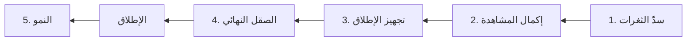

<!-- نسخة احتياطية من المستند الحيّ "خطة جزم للمرحلة القادمة"
     الأصل (يُحدَّث أولاً): https://claude.ai/artifact/FArHCwFjm6quiTRMmRavoe
     يُعاد توليد هذا الملف مع كل دفعة. آخر مزامنة: 2026-10-18 (مراجعة 98) -->

# خطة جزم للمرحلة القادمة

**آخر مزامنة مع المستند: 2026-10-18 (مراجعة 98 — v35.9 1792313787)** · نسخة احتياطية — المستند الحيّ هو الأصل

الترتيب: نسدّ الثغرات أولاً، ثم نكمل المشاهدة، ثم نجهّز للإطلاق، والصقل في الآخر. كل دفعة يفحصها المحاكي قبل التسليم، وأنت تجرّب فقط ما لا يراه.

## الصورة الكاملة

v35.9 (1792313787) جاهزة للرفع: بناء جديد للخطوة 1.8 فيه قرارك على ملاحظة فحص 1 (الحالة "متصل" لحظة نهاية المباراة)، بانتظار فحصه القصير. فحوص 1.8 الثمانية على البناء السابق 1791040331 ناجحة. منجز قبلها: 1.1 حتى 1.7 و1.3 (v35.8). التالي: 1.10 (أمان النصوص) ثم 3.6. وبانتظار قرارك: 1.9 (انقطاع اللوبي الجماعي) و1.11 (الخروج ثم الدخول بنفس الصفحة — جديد).

لا ننتقل لمرحلة قبل أن تُغلق التي قبلها بتجربتك.

**المكتمل والمجرَّب حتى الآن:**

- اللعب أونلاين ثنائي وجماعي (2–4 لاعبين) مع الساعة المركزية (بنك الوقت) والأدوات.
- المطابقة العشوائية الجماعية مع التصويت، والغرفة بالكود مع وراثة المضيف.
- الانقطاع ومهلة السماح (10 ثوانٍ)، ومؤشر الحضور وآخر ظهور.
- المشاهدة، المرحلة 1: المشاهدة بالكود، عدّاد المشاهدين، زر الكتم.
- المحاكي متعدد اللاعبين (tests/sim): 59 سيناريو (منها 11 لدعوات الأصدقاء و1 للحضور بـ23 فحصاً)، و5 مستكشفات عشوائية، وفحوص نافذة نهاية المباراة. ومنذ v35.7 طبقة ثانية (tests/realsdk): 28 فحصاً بحزمة Firebase الحقيقية لسلوكها الداخلي (إلغاء المعاملات، أوامر الانقطاع).

## المرحلة 1 — سدّ الثغرات

أولاً نغلق الثغرات التي كشفها المحاكي، كل واحدة بدفعة مستقلة.

| الخطوة | ماذا ولماذا | الخطورة | الفحص | الحالة |
| --- | --- | --- | --- | --- |
| 1.1 رفع v35.2 | تصليح زر البدء عند غير المضيف بالغرفة بالكود، وتوسعة المحاكي | منخفضة | المحاكي: كله ناجح. أنت: المضيف يخرج ويعود (بلا زر بدء)، وبحث وحيد مع تبويب بالخلفية دقيقتين | منجز |
| 1.2 إغلاق المنشئ لتبويبه في اللوبي | إغلاق التبويب أو تحديثه أو انقطاع شبكته يحذف الغرفة: بالعشوائي يُطرد الباقون، وبالكود يعلقون بلا إشعار. الحل: يُزال المنشئ وحده ويُورَّث المضيف | متوسطة | المحاكي: اختباراتها "المعروفة" تصير ناجحة. أنت: إغلاق تبويب المنشئ وتحديث صفحته، بالنوعين | منجز |
| 1.3 انضمام ثنائي محمي | لاعبان يبحثان بنفس اللحظة يدخلان على نفس المنتظر، والإلغاء لحظة الانضمام يترك غرفة فارغة ويسحب المُلغي لمباراة. الحل (v35.8): الانضمام بمعاملة ذرّية تنجح فقط لغرفة ما زالت تنتظر وحدها مع منشئها (منضمّان بنفس اللحظة: واحد يدخل والآخر يكمل البحث)، والإلغاء يفصل المستمعين أولاً ثم يحذف الغرفة ذرّياً إن كانت ما زالت تنتظر. من سبق الإلغاءَ بلحظة وانضمّ تُلغى مباراته قبل بدئها برسالة واضحة ولا تُحسب لأحد. ومعها: الغرفة بالكود تنضمّ بنفس المعاملة وإلغاؤها لا يمنح المنضمّ بنفس اللحظة فوزاً، ومن اختفت غرفة خصمه قبل البدء لا يعلق. ومعها من المراجعات الخمس: انقطاع لحظي للمنتظر كان يمسح غرفته وهو ينتظر فيها للأبد (قديم)، فصارت تعود وحدها، والإلغاء لا يترك غرفة بلا صاحب ولا بقايا | متوسطة | المحاكي: السباقات الثلاثة المعروفة صارت ناجحة، مع سيناريوهات جديدة ومستكشف عشوائي للبحث الثنائي (300 جلسة سليمة)، و18 فحصاً جديداً بحزمة Firebase الحقيقية، وخمس جولات مراجعة مستقلة. أنت: جولة ثنائي عادية، وإلغاء البحث، وغرفة بالكود مع انقطاع قصير لمنشئها. فحصك على 1790462091: 1 ✅ (مباراة عشوائية كاملة، والنتيجة صحيحة)، 2 ✅ (إلغاء البحث لا يترك غرفة، والبحث التالي يلتقي)، 3 ✅ بالثنائي (الغرفة عادت بعد انقطاع منشئها ودخلها الصديق)، وبالغرفة الجماعية كشف خللاً قديماً منفصلاً (1.9)، 4 ✅ (إلغاء غرفة الكود: الصديق يرى "الغرفة غير موجودة!")، 5 ✅ (دعوة صديق: قبول ورفض، وكشف زر الدعوة العالق بعد المباراة ← 1.8) ← الخطوة منجزة | منجز |
| 1.4 نص زر البدء بالغرفة بالكود | العدد المختار حدّ أقصى لا شرط (قرارك بعد فحص v35.4). الزر يقول "ابدأ بلاعبَين (من 3)" بعدد ناقص، و"ابدأ المباراة" مع "اكتمل العدد" عند الاكتمال | منخفضة | المحاكي: نص الزر والجملة تحته بالحالتين. أنت: نظرة على النص | منجز |
| 1.5 نافذة نهاية المباراة: الغائب وإحصائياتك | كشفها فحصاك 3 و4: المقعد الفارغ ظهر في النتيجة باسم "لاعب 1" برصيد 0، وإحصائيات كل الأجهزة كانت تُحسب للمقعد 1. ومعها: المشاهد تُسجَّل عليه خسارة ويكسب جواهر المقعد 1، وشارة المستوى على بطاقة غير صاحبها. الحل: النتيجة من مصدر واحد (من لعب فعلاً + مقعدك أنت) | منخفضة | المحاكي: فحوص جديدة لنافذة النهاية (37 تأكيداً، وعلى v35.4 تعيد الخلل حرفياً). أنت: غرفة غادرها منشئها قبل البدء، ومباراة جماعية يفوز فيها غير المقعد 1 | منجز |
| 1.6 تسجيل نهايات الانسحاب | الفوز بانسحاب الخصوم يعرض رسالة فقط: لا فوز يُسجَّل ولا خبرة، وعملات الجواهر من المباراة تضيع. والمنسحب بالزر لا تُسجَّل عليه خسارة. الحل: كل النهايات تمرّ على نافذة النتيجة | متوسطة | المحاكي: 7 سيناريوهات جديدة (انسحاب، إغلاق تبويب، انقطاع حقيقي لكل طرف، انقطاع طويل، مباراة ثانية، آخر الباقين، ختم انقطاع متأخر) وفحوص النافذة، ومراجعتان مستقلتان. أنت: انسحاب بالزر بالثنائي، وإغلاق تبويب الخصم، وآخر الباقين بالجماعي | منجز |
| 1.7 الخروج أثناء مباراة جماعية جارية | كشفها فحصك 6: من خرج (نفد وقته، أو انقطع ولم يعد خلال المهلة) يعود مشاهداً بلا توضيح، وزر الخروج يحذّره من خسارة وقعت أصلاً. ووراءها: خسارته لا تُسجَّل إن أغلق التبويب، وجواهره تتبع صبره لا ما حدث، والمراكز قد تتكرر (الخارجون يُرتَّبون بالنقاط في النهاية). الحل: النتيجة تُسجَّل لحظة الخروج مع بطاقة واضحة (تابع المشاهدة / العودة للقائمة)، وخروج هادئ بعدها، والمراكز بترتيب الخروج، وسبب الخروج محفوظ في الغرفة (نفد وقته / انقطع / انسحب). الجواهر بالمعيار العالمي (قرارك): تُحفظ لمن أكمل المباراة أو أُقصي بقاعدة لعب (نفاد الوقت)، وتضيع بالانسحاب أو بالانقطاع بلا عودة خلال المهلة، والتحذير قبل الانسحاب وبطاقة الخروج يذكران بالرقم ما يضيع. ومعها من المراجعات: ختم انقطاع المنشئ كان يُمسح عند البدء فلا يُخرَج بانقطاعه، والانسحاب بلا شبكة كان يعلّق الزر أو يترك مقعداً عالقاً | متوسطة | المحاكي: 10 سيناريوهات جديدة (انقطاع ثم عودة، نفاد الوقت، ترتيب الخروج، الخارج يتابع للنهاية، اكتمال اللوحة أثناء الغياب، خروجان متقاربان، انقطاع المنشئ، الانسحاب الصامت) + 9 فحوص بحزمة Firebase الحقيقية، وخمس جولات مراجعة مستقلة. أنت: فحص 6 بالترتيبين (البطاقة، الخروج الهادئ، المراكز)، وانسحاب وأنت بلا شبكة. فحصك: المباراة 1 ✅، وكشفت أن علامة المشاهدة لم تكن تظهر فوق اللوحة (أُضيفت في 1790420518). المباراة 2 ✅ على 1790420518: نفاد الوقت والبطاقة، علامة المشاهدة، الخروج الهادئ، الانسحاب بلا شبكة، آخر الباقين والمراكز. المباراة 3 (ثنائي) ✅ و4 (ضد الكمبيوتر) ✅ ← الخطوة منجزة | منجز |
| 1.8 دعوات الأصدقاء | كشفها تتبّع سؤالك عن طرق الدخول (أخطاء قديمة منذ نظام الدعوات). رفضٌ متأخر لدعوة قديمة يُخرج صاحبها من أي مباراة يلعبها وقتها، فيأخذ خصمه فوزاً مجانياً: مستمع الرفض يبقى مفعّلاً بعد الدعوة ويغادر أي غرفة. والدعوة التي ألغاها صاحبها تبقى عند صديقه بلا حدّ، وقبولها يعيده للقائمة بصمت. وزر "دعوة" يبقى ⏳ معطّلاً بعد مباراة قُبلت دعوتها (أو بعد إلغائها) حتى تحديث الصفحة (فحصك 5 لـv35.8): لا يُرجَع إلا عند الرفض. الحل: الرفض يحمل رمز الغرفة ولا يُعمل به إلا إن كان صاحب الدعوة ما زال ينتظر فيها، والمستمع يُفصل عند البدء أو الإلغاء، والدعوة تُمسح مع إلغاء صاحبها وتنتهي بعد مدة، وقبول دعوة انتهت يعرض رسالة واضحة، والزر يرجع مع أي نهاية للدعوة (قبول ثم نهاية المباراة، رفض، إلغاء، فشل) | متوسطة | المحاكي (v35.9): 11 سيناريو + مستكشف عشوائي — القبول ثم دعوة ثانية، الرفض، رد متأخر أثناء مباراة، دعوة ملغاة ثم قبولها، المدعوّ في مباراة، القبول من بحث أو غرفة، انقطاع صاحبها، المهلة، الدعوة المتبادلة، تسجيل الخروج. والحزمة الحقيقية: السحب والمسح المشروطان. أنت: قائمة v35.9 (8 فحوص) — فحصك 1 ✅، مع ملاحظة: حالة "في مباراة" تبقى ظاهرة عند الأصدقاء وصاحبها على شاشة النتيجة (سلوك قديم منذ v30، لا من 1.8). المقترح: تصير "متصل" لحظة نهاية المباراة — بانتظار قرارك · فحص 2 (الرفض) ✅ · فحص 3 (إلغاء صاحبها) ✅ · فحص 4 (المهلة) ✅ · فحص 5 (المدعوّ في مباراة) ✅ · فحص 6 (القبول أثناء البحث) ✅ · فحص 7 (قطع نت صاحب الدعوة) ✅ · فحص 8 (زر تحدي بالمحادثة) ✅ · الاختياريان 9 (دعوة ثانية أثناء قائمة) و10 (تسجيل الخروج أثناء الانتظار): غطّاهما المحاكي (لا حساب ثالث عندك) ✅ · بناء 1792313787: الحضور "متصل" لحظة نهاية المباراة (قرارك) — المحاكي: قسم "الحضور" (23 فحصاً) — بانتظار فحصك | جاهز للرفع |
| 1.9 انقطاع قصير في لوبي الغرفة الجماعية | كشفه فحصك 3 لـv35.8 (غرفة جماعية بالكود للاعبَين، خلل قديم لم تلمسه 1.3). في اللوبي يُزال مقعد من ينقطع فوراً (قصداً: كي لا ينتظر أحد غائباً)، لكن حين يعود الاتصال لا يُعاد أحد لمقعده: المنشئ يبقى ينتظر في لوبي ليس فيه، ومن دخل بالكود أثناء الانقطاع يأخذ المقعد 1 ويصير مضيفاً فلا يرى أحدهما الآخر. وإن بقيت الغرفة فارغة يمسحها منظّف الغرف فيرى الصديق "الغرفة غير موجودة!". ويصيب المنضمّ مثل المنشئ. الحل المقترح (كإصلاح الثنائي): الإزالة الفورية تبقى، ومن يعود اتصاله وهو في اللوبي يستعيد مقعداً تلقائياً بمعاملة الانضمام نفسها، وإن مُسحت الغرفة وهو منشئها يعيدها بنفس الكود، مع رسالة "نرجعك للغرفة" أثناء ذلك | متوسطة | المحاكي وحزمة Firebase الحقيقية: انقطاع المنشئ والمنضمّ مع دخول صديق أثناءه وبدونه، ومسح الغرفة الفارغة. أنت: فحص 3 نفسه بالغرفة الجماعية | بانتظار قرارك |
| 1.10 أمان النصوص (حقن HTML) | كشفها تتبّع 1.8 (خلل قديم). أسماء اللاعبين ونصوص الرسائل تُدرج في الصفحة كشيفرة HTML في عدة أماكن: معاينة آخر رسالة في قائمة الرسائل، قائمة لوبي الغرفة الجماعية ونافذة التصويت، لوحة متصدري تحدي اليوم، وسجل المباريات. من يضع في اسمه أو رسالته شيفرة يستطيع تشغيلها على جهاز من يرى الاسم (في لوحة المتصدرين: كل اللاعبين). الحل: كل نص من مستخدم يُعرض كنص لا كشيفرة، بمراجعة كل innerHTML في المشروع | عالية | المحاكي: أسماء ورسائل فيها رموز HTML تظهر كما هي. أنت: اسم فيه \<b>تجربة\</b> يظهر حرفياً في اللوبي والتصويت والرسائل | التالي |
| 1.11 الخروج ثم الدخول بنفس الصفحة + تجمّد حالة الأصدقاء | كشفتها مراجعة بناء الحضور (خلل قديم منذ v35.0 على الأقل). (أ) عند إضافة صديق أو حذفه تُرسم بطاقات الأصدقاء من جديد، لكن متابعة الحضور تبقى مربوطة بالبطاقات القديمة، فتتجمّد حالة كل صديق على "⚫ غير متصل" حتى إعادة تحميل الصفحة. (ب) تسجيل الخروج ثم الدخول دون إعادة تحميل يعيد تشغيل تهيئة الأصدقاء والرسائل والإشعارات فوق القديمة: نفس التجمّد، وزر الرسائل ينفتح وينسكّر بنفس الضغطة فلا يظهر، ومستمعو الحساب السابق يبقون شغالين. الحل (كالتطبيقات العالمية): إعادة تحميل الصفحة بعد تسجيل الخروج، ومتابعة حضور تخدم البطاقة الظاهرة حالياً | متوسطة | المحاكي: إضافة/حذف صديق والحالة تبقى حيّة، والخروج ثم الدخول يبدأ نظيفاً. أنت: احذف صديقاً وأضفه من جديد ثم راقب حالته، واخرج وادخل ثم افتح الرسائل | بانتظار قرارك |

فحوصك الأربعة على v35.4 ثبّتت 1.1 و1.2، وكشفت خللي نافذة النهاية (1.5)، وتتبّعهما كشف 1.6، وفحصك 6 على v35.6 كشف 1.7. ترتيب التنفيذ: v35.5 (1.4 و1.5)، ثم v35.6 (1.6)، ثم v35.7 (1.7)، ثم v35.8 (1.3)، ثم v35.9 (1.8)، ثم 3.6. ومع 1.3 (v35.8) اختفت كل الأخطاء "المعروفة" من تقرير المحاكي.

## المرحلة 2 — إكمال المشاهدة

الهدف: مشاهدة أي مباراة بنقرة واحدة، بلا أكواد. المحرّك جاهز من المرحلة 1، وتبقى الواجهة والفهرسة.

| الخطوة | ماذا ولماذا | الخطورة | الفحص | الحالة |
| --- | --- | --- | --- | --- |
| 2.1 عدّاد المشاهدين وزر الكتم | يراه اللاعبون والمشاهدون | — | مُجرَّب | منجز |
| 2.2 حالة "يشاهد مباراة" | حالة خامسة في مؤشر الحضور يراها أصدقاؤك | منخفضة | المحاكي لا يغطي الحضور. أنت: صديق يشاهد ← تظهر حالته عندك | لاحقاً |
| 2.3 زر "شاهد" بجانب الصديق | الصديق الذي حالته "في مباراة" تدخل مباراته بنقرة (نحفظ كود غرفته مع حالته) | منخفضة–متوسطة | المحاكي: نضيف له دخول المشاهد وخروجه. أنت: الدخول بنقرة، شكل اللوحة، الخروج | لاحقاً |
| 2.4 قائمة المباريات العامة | فهرس للمباريات الجارية وشاشة اختيار. الترتيب: الأصدقاء، ثم الأكثر مشاهدة، ثم الأحدث | متوسطة | المحاكي: نضيف الفهرسة. أنت: الشكل والترتيب والدخول | لاحقاً |
| 2.5 إزالة زر "شاهد بالكود" | كان مدخل اختبار مؤقتاً؛ الكود يبقى للانضمام كلاعب | منخفضة | أنت: نظرة سريعة | لاحقاً |

المشاهدة متاحة للجميع حتى الضيف، وخيارات الخصوصية مؤجّلة للمرحلة 5. فهرس 2.4 نصمّمه بحيث يخدم أداء البحث أيضاً (3.2).

## المرحلة 3 — تجهيز الإطلاق

قبل فتح اللعبة للناس نقوّي الأساس: منطق المطابقة، والأداء، والأمان.

| الخطوة | ماذا ولماذا | الخطورة | الفحص | الحالة |
| --- | --- | --- | --- | --- |
| 3.1 مطابقة بمراحل واضحة | تجميع ← تصويت ← بدء بدل قرارات موزّعة على الأجهزة، فتقلّ الحالات النادرة. ترتيب للكود الموجود لا كتابة من جديد | عالية (يحميها المحاكي) | المحاكي: أساسي، كل الفحوص تنجح. أنت: جولة عامة | لاحقاً |
| 3.2 أداء البحث | كل بحث (ثنائي وجماعي) يقرأ كل الغرف بما فيها سجلات حركات المباريات، فيبطؤ ويكلف مع الكثرة. الحل: فهرس خفيف للغرف المفتوحة، ومعه فحص دوري رخيص ينقل المنتظر الأحدث لغرفة الأقدم (باحثان ثنائيان بنفس اللحظة بلا منتظر ينشئ كلّ منهما غرفته ولا يرى الآخر — ظهر في تصميم 1.3). (غرف الثنائي التي تبقى "جارية" بعد النهاية الطبيعية انتقلت إلى 3.6: دالة الإنهاء الذرّية نفسها تنظّفها) | متوسطة | المحاكي: نعم. أنت: جولة عامة | بانتظار قرارك |
| 3.3 مراجعة قواعد أمان Firebase | من يستطيع قراءة وكتابة ماذا؛ ضرورية قبل فتح اللعبة للناس | متوسطة | المحاكي: لا. أنت: الشاشات الأساسية بعدها | بانتظار قرارك |
| 3.4 إعلان نفاد الوقت من مصدر واحد | اليوم كل جهاز يعلن النفاد بنفسه، فقد يسبق جهازٌ غيرَه بلحظة عند النهاية بالوقت (موثّق) | منخفضة | أنت: مباراة تنتهي بالوقت على جهازين | لاحقاً |
| 3.5 توحيد مستمعي الحركات | للثنائي والجماعي مستمعان متشابهان؛ تنظيف يسهّل الصيانة (غير عاجل) | منخفضة | أنت: مباراة ثنائي وأخرى جماعية | لاحقاً |
| 3.6 نظام الحضور والعودة (نبض + مهلة عودة) | الانقطاع ينهي الثنائي فوراً بلا رجعة، والجماعي ينتظر 10 ثوانٍ لكنه ينتظر لحظة يكتشف فيها السيرفر موت الاتصال: فورية عند إغلاق نظيف، ومتأخرة في نمط الطيران (فحصك v35.6). الحل الكامل: نبض حضور كل 3 ثوانٍ (3 نبضات مفقودة = انقطاع مؤكّد بلا انتظار السيرفر)، وعلامة انقطاع بدل إنهاء الغرفة، ومهلة عودة 30 ثانية للثنائي و10 للجماعي بشاشة انتظار وبنك وقت موقوف للطرفين، وعودة سلسة من سجل الحركات والساعة، وزر "أعلن النتيجة الآن" لمن ينتظر، ونهاية واحدة ذرّية (transaction) تقتل الفوز المزدوج من جذره. ويشمل سباقاً نادراً موثّقاً في v35.7: انقطاع لحظة بدء المباراة يسبق إلغاء أمر "إزالة اللوبي" فيحذف الخادم المقعد. ومن مراجعة v35.8: علامة الانقطاع تحمل هوية كاتبها، وعلامة لا تطابق الجالس في المقعد تُهمل (اليوم قد يُنهي أمرُ انقطاعٍ شارد من منضمّ سابق مباراةَ المنتظر التالية بفوز لا يستحقه — نادر جداً). تُنفَّذ بعد 1.8 مباشرة | عالية (تمسّ أخطر مسار: النهايات) | المحاكي: انقطع وعاد، انقطع ولم يعد، انقطع الطرفان، عاد بعد انتهائها، تبويب في الخلفية، وساعة موقوفة. أنت: قطع شبكة ثوانٍ ثم عودة أثناء مباراة، ونمط طيران بلا عودة | التالي |
| 3.7 حماية الخبرة من الانسحاب المتفق عليه | منذ v35.6 الفوز بانسحاب الخصم يعطي خبرة كاملة، فيستطيع حسابان تبادل الانسحاب الفوري لجمع خبرة وانتصارات. اقتراح: خبرة فوز الانسحاب فقط إذا لُعب نصف اللوحة على الأقل. ومعها كشف الخمول كالألعاب العالمية: من يترك وقته ينفد بلا أي حركة ليحفظ جواهره بدل الانسحاب يُعامَل كمنسحب | منخفضة | المحاكي: فحوص النافذة. أنت: انسحاب مبكر ومتأخر | بانتظار قرارك |

3.2 و3.3 إضافتان جديدتان مني لم نناقشهما بعد، لذلك حالتهما "بانتظار قرارك".

## المرحلة 4 — الصقل النهائي

الصقل آخر شيء، مثل بوليش السيارة: شكل فقط بلا تغيير في المنطق، وكله تجرّبه أنت بعينك.

| البند | التفاصيل | الحالة |
| --- | --- | --- |
| شاشة الإعدادات | لمسات نهائية | لاحقاً |
| شكل الجوهرة | توحيد شكلها بين اللوحة والأيقونات | لاحقاً |
| نافذة تأكيد مخصّصة | بدل نافذة المتصفح عند الانسحاب، بدالة عامة تُستعمل في كل مكان، مع تحسين شكل الإشعارات. ومعها بطاقة ملخّص للمنسحب فوق القائمة بدل التوست العابر (الخسارة، مركزه في الجماعي، الجواهر الضائعة بالرقم)، كما تعرض ألعاب الطاولة الكبرى النتيجة لمن استسلم (سؤالك بعد المباراة 3) | لاحقاً |
| دقّة نصوص النهاية والعملات | عنوان فوز آخر الباقين حسب سبب خروج كل خصم (اليوم "انسحب جميع خصومك" حتى لو نفد وقت أحدهم أو انقطع)، وصيغة العدد مع العملة (3 إلى 10 عملات، 11 فأكثر عملة) في النافذة والتحذير والبطاقة | لاحقاً |
| لون نص الدور | يتلوّن بلون صاحب الدور بدل التركوازي الثابت | لاحقاً |
| بطاقة اللاعب الخارج | بلا شطب. نجرّب 4 بدائل جنب بعض (شارة وحدها، إطار متقطع، رمز باب، شريط جانبي) + فكرة الشريط المصغّر | بانتظار قرارك |
| ظهور لوحة المشاهد | اللوحة تظهر قبل خطوطها بأقل من ثانية؛ نجرّب بناءها خارج الشاشة ثم إظهارها جاهزة | لاحقاً |
| حالة "خامل" + "الظهور كغير متصل" | لمن يترك اللعبة مفتوحة بلا استعمال، وخيار خصوصية بالإعدادات | لاحقاً |
| عدّاد تصاعدي لمدة البحث (اختياري) | للاعب الوحيد: كم صار له يبحث، بلا إيحاء بحدث عند الصفر | بانتظار قرارك |
| رسومات موحّدة بدل الإيموجي (اختياري) | شكل الإيموجي يختلف بين الأجهزة؛ الرسومات توحّده وتعطي هوية مميّزة | بانتظار قرارك |

## المرحلة 5 — النمو بعد الإطلاق

بعد الإطلاق نبني حسب ما يحتاجه اللاعبون فعلاً؛ لكل فكرة شرط يحدّد وقتها.

| الفكرة | متى |
| --- | --- |
| البطولات | بعد الإطلاق، بدءاً ببطولة أصدقاء خاصة (لا تحتاج قاعدة لاعبين كبيرة) |
| الاقتصاد الكامل: جواهر، متجر، إعلانات مكافأة، شراء + لوحة التحكم | بعد الإطلاق |
| ربح المشاهدة: إعلان قبل المشاهدة أولاً، ثم التشجيع المدفوع | بعد الاقتصاد |
| تفاعل المشاهدين: تشجيع بالإيموجي ودردشة، بلا تأثير على النتيجة | بعد قائمة المباريات العامة |
| خصوصية المباراة: عامة / أصدقاء / مغلقة | بعد قائمة المباريات العامة |
| إعادة المباريات ومشاركة رابطها | بعد اكتمال المشاهدة |
| الغرف المتعددة للمطابقة | عندما يتكرر انتظار لاعبين عددهم يكفي لمباراة (مؤشر في لوحة التحكم) |
| الجمهور الشخصي لكل لاعب | مع البطولات وهوية اللاعبين |
| نظام سمعة وعقوبات للانسحاب | مع المطابقة التنافسية |
| ذكاء آلة "خارق" (نظرية السلاسل) | مشروع منفصل، أي وقت |
| توزيع العناصر الذكي، البيئات المتعددة، أدوات جديدة | بمعيار "قليل ومتقن" |
| تطبيق iOS وAndroid | المرحلة الأخيرة |

## ماذا يغطي المحاكي وماذا تجرّب أنت

المحاكي يغطي منطق الغرف والمطابقة كاملاً؛ أنت تجرّب ما تراه العين وما يحدث داخل المباراة.

| المجال | المحاكي | أنت |
| --- | --- | --- |
| البحث الجماعي: تجميع، تصويت، رفض، رجوع، منتظرون، بدء | يغطيه كاملاً | لا داعي، إلا شكل الشاشات |
| 4 لاعبين | يغطيه | لا داعي |
| الغرفة بالكود: التاج، الوراثة، المقاعد، البدء، الامتلاء | يغطيه | لا داعي |
| البحث الثنائي: الانتظار، البدء، الإلغاء | يغطيه | لا داعي |
| الشكل والإحساس: نصوص، ألوان، وميض، ترتيب | لا | نعم |
| المتصفح الحقيقي: تبويب بالخلفية، تحديث الصفحة، الموبايل | لا | نعم |
| الشبكة الحقيقية: بطء، انقطاع، مهلة السماح | جزئياً (إغلاق تبويب وانقطاع عابر). ومنذ v35.7 طبقة بحزمة Firebase الحقيقية: الخروج بلا شبكة، والانقطاع أثناء الانسحاب وبعد البدء | نعم |
| داخل المباراة: اللوحة، الأدوار، الساعة، الأدوات، النقاط، النهاية | جزئياً: نافذة النهاية (الترتيب وما يُسجَّل)، ونهايات الانسحاب، والخروج أثناء المباراة (v35.5–v35.7). اللوحة والأدوار والساعة لا | نعم |
| المشاهدة | ليس بعد (نضيفها مع المرحلة 2) | نعم |
| الحضور، الأصدقاء، الدعوات، الدردشة | الدعوات: نعم منذ v35.9 (11 سيناريو + مستكشف عشوائي). الحضور: جزئياً منذ بناء 1792313787 (يتبع المباراة — 23 فحصاً). الأصدقاء والدردشة: لا | نعم |
| ضد الكمبيوتر واللعب المحلي | لا | نعم |

بعد كل دفعة أرسل لك قائمة قصيرة فيها فقط ما يخصّ تلك الدفعة من عمود "أنت". وكلما زادت تغطية المحاكي يتحدّث هذا الجدول.

## طريقة الشغل في كل دفعة

كل خطوة في الجداول أعلاه تمرّ بنفس الدورة الست:

1. أعدّل الكود بدفعة صغيرة؛ الخطير يكون وحده حتى نعرف مصدر أي عطل.
2. أشغّل المحاكي؛ لا تسليم إلا إذا نجح كله.
3. أوثّق التغيير في IDEAS.md.
4. أسلّمك الحزمة "جاهزة للرفع" مع شيئين: ما غطّاه المحاكي والفحوص الآلية بكلام واضح، وقائمة فحص يدوي خطوة بخطوة فيها الأزرار والنصوص المتوقعة بالضبط. اسم ملفها يحمل رقم النسخة ورقم البناء (مثل Jazam\_v35.7\_1790420518.zip): النسخة ثابتة طوال فحص الخطوة، والبناء يتغيّر مع كل حزمة ويطبعه الـconsole بعد الرفع.
5. ترفعها عبر GitHub Desktop وتجرّب القائمة.
6. ترسل لي النتيجة، فنحدّث الحالة هنا وننتقل للخطوة التالية.

قاعدتان ثابتتان: عندما تقول "سجّل بس" أوثّق بلا تعديل، وأي فكرة جديدة تُضاف لهذه الخطة قبل تنفيذها.
